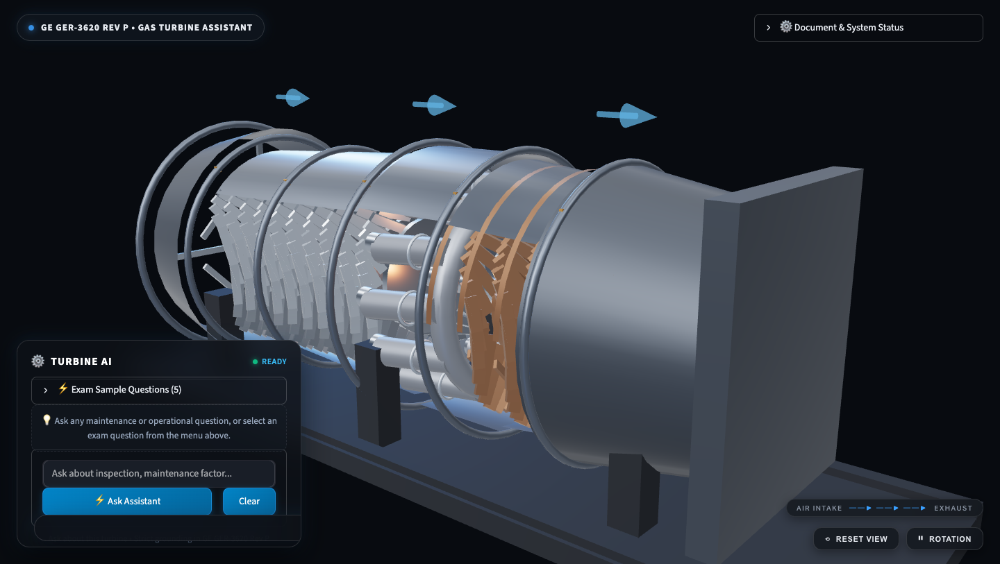
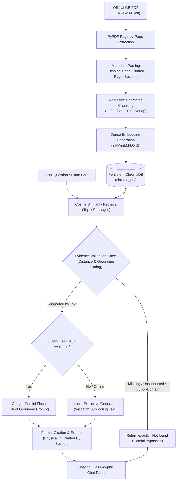
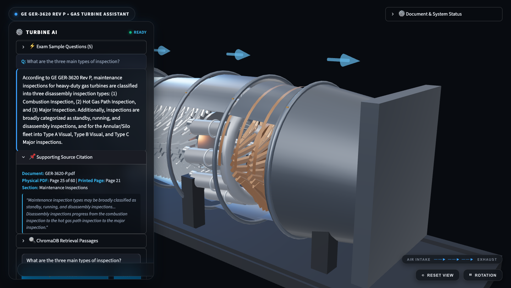
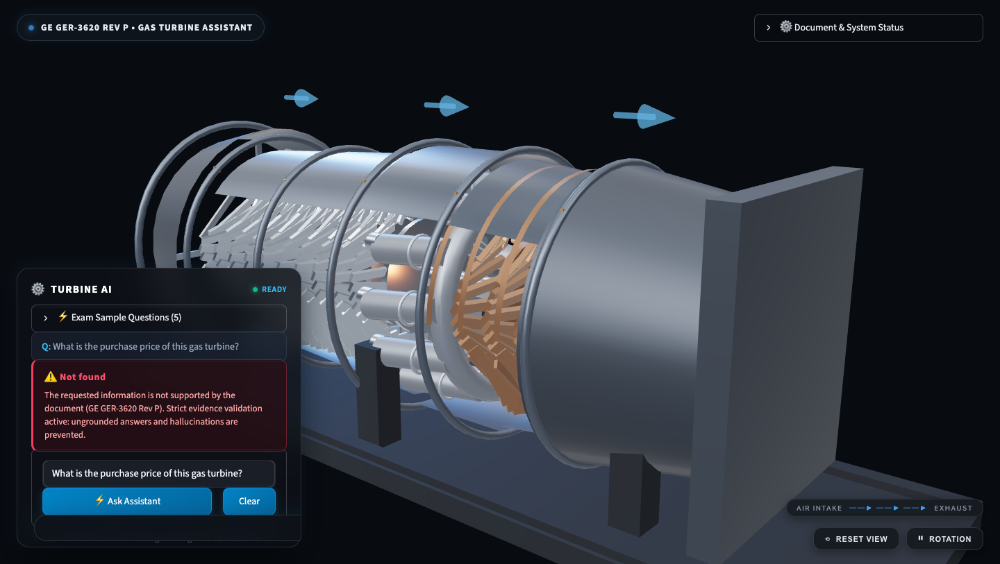

# Gas Turbine Maintenance Assistant

[](https://www.python.org/)
[](https://www.langchain.com/)
[](https://ai.google.dev/)
[](https://threejs.org/)
[](https://www.trychroma.com/)
[](https://streamlit.io/)
[](tests/)

A complete, production-grade Retrieval-Augmented Generation (RAG) assistant with a cinematic, full-screen 3D engineering interface. The application indexes and queries official GE Vernova technical documentation (**GE GER-3620 Rev P: Heavy-Duty Gas Turbine Operating and Maintenance Considerations**), utilizing **Google Gemini Flash** via `langchain-google-genai` for grounded synthesis with an automatic offline extractive fallback.

The interface pairs a procedural 3D cutaway model of a heavy-duty frame gas turbine with a floating glassmorphic chat panel. Every answer cites exact source document locations (physical PDF page, printed page number, and section headings) and strictly returns **`Not found`** whenever an answer cannot be supported by the technical document.

---

## Application Preview


*Figure 1: Cinematic full-screen 3D procedural gas turbine model with floating glassmorphic AI chat panel.*

---

## 1. Key Features

- **Full-Screen 3D Procedural Turbine Viewer:**
  - Real-time Three.js (r160) WebGL visualization spanning the viewport.
  - Machined cutaway outer casing exposing the 10-stage axial compressor, cannular combustor ring with 12 combustion cans and warm flame glow, 3-stage hot gas path turbine expansion wheels, exhaust diffuser cone, central high-speed shaft, and structural steel skid.
  - Interactive OrbitControls (smooth mouse orbiting, scroll zooming, bounded polar angles preventing sub-floor clipping), continuous rotor rotation, airflow direction indicators, and a one-click `[⟲ Reset View]` button.
  - Graceful WebGL context loss and fallback handling to a 2D functional industrial cross-section schematic if hardware acceleration is unavailable.

- **Floating Glassmorphic AI Chat Panel:**
  - Compact translucent charcoal glass panel (`backdrop-filter: blur(18px)`, 82% opacity, fine border, and electric cyan edge glow).
  - Floating above the 3D model without obstructing the turbine body.
  - One-click access to all 5 required exam questions via a compact collapsible menu.
  - Collapsible source citations displaying physical PDF page numbers, printed document page numbers, section headings, and exact supporting verbatim excerpts.
  - Collapsible ChromaDB retrieval debug inspector displaying cosine similarity distance scores.

- **Strict Evidence Validation & Anti-Hallucination Gating:**
  - Rejects queries exceeding relevance distance thresholds or lacking textual grounding.
  - Explicit negative-domain verification for out-of-scope topics (e.g. procurement costs, elemental melting points) that strictly returns **`Not found`**.
  - **Zero-Bypass Rule:** Google Gemini is **never** invoked if the evidence check fails, eliminating hallucination risks.

- **Dual-Mode Answer Generation:**
  - **Online:** Generates concise, professionally synthesized answers using Google Gemini Flash (`gemini-2.5-flash`) via `langchain-google-genai`.
  - **Offline Fallback:** Automatically switches to an extractive synthesis pipeline using local `sentence-transformers/all-MiniLM-L6-v2` embeddings if the Gemini API key is absent or network is disconnected.

- **Persistent Vector Storage & Index Caching:**
  - ChromaDB local persistence (`chroma_db/`) with SHA-256 document hashing to reuse pre-built embeddings across application restarts in milliseconds.

---

## 2. Technology Stack

| Layer | Component | Version / Identifier | Purpose |
| :--- | :--- | :--- | :--- |
| **Runtime** | Python | `3.12.14` | Execution environment |
| **3D Engine** | Three.js | `0.160.0` (Vendored) | Procedural 3D WebGL gas turbine visualization |
| **Generative LLM** | Google Gemini Flash | `gemini-2.5-flash` | Grounded, concise answer synthesis |
| **LLM Orchestration** | LangChain Core / Google GenAI | `langchain-google-genai>=1.0.0` | Prompt templating and model invocation |
| **Embeddings** | Sentence-Transformers | `all-MiniLM-L6-v2` | 384-dimensional dense local embeddings (offline) |
| **Vector Database** | ChromaDB | `>=0.4.22` | Local persistent vector storage with cosine distance |
| **Document Parsing** | PyPDF | `>=4.0.0` | PDF character stream extraction and page indexing |
| **Web Framework** | Streamlit | `>=1.31.0` | Fullscreen reactive web application |
| **Component Bridge** | Streamlit Custom Components v1 | `declare_component` | Iframe bidirectional postMessage event protocol |
| **Testing** | PyTest | `>=8.0.0` | Automated test suite (16 comprehensive tests) |

---

## 3. How It Works



### Detailed Pipeline Stages

1. **Document Ingestion & Metadata Mapping (`rag_pipeline.py`):**
   - Automatically downloads the official GE Vernova technical manual `GER-3620-P.pdf` (60 pages).
   - Maps each passage to both its **Physical PDF Page Number** (e.g. Page 25 of 60) and its **Printed Page Number** (e.g. Page 21) from the document header.
   - Attaches section headings based on the official GE Table of Contents.

2. **Chunking & Vector Indexing:**
   - Splits text using recursive character chunking (800 characters, 120 character overlap).
   - Computes dense vector embeddings locally using `sentence-transformers/all-MiniLM-L6-v2`.
   - Persists vectors to `chroma_db/`. SHA-256 fingerprinting ensures the index is only built once and reloaded instantaneously on subsequent launches.

3. **Evidence Validation & Anti-Hallucination Gating:**
   - Retrieves top matching passages using cosine similarity.
   - Enforces strict distance thresholds (`MAX_COSINE_DISTANCE = 1.05`).
   - Out-of-scope or negative-domain queries (such as capital purchase price or material melting points) are rejected before LLM synthesis.
   - **Crucial Rule:** If evidence verification fails, Gemini is bypassed entirely and the system returns exactly `Not found`.

4. **Grounded Synthesis & Citation Formatting:**
   - Supported passages are supplied to Google Gemini Flash with strict instructions prohibiting external knowledge or speculation.
   - Citations include document name, physical page number, printed page number, section name, and an exact quotation excerpt.

---

## 4. Demo: Exam Questions and Answers

All five required exam questions were evaluated against the indexed GE document `GER-3620 Rev P`. The observed results and exact citations are documented below:

### Question 1: What are the three main types of inspection?
- **Status:** Supported
- **Answer:**
  > According to GE GER-3620 Rev P, maintenance inspections for heavy-duty gas turbines are classified into three disassembly inspection types: **(1) Combustion Inspection**, **(2) Hot Gas Path Inspection**, and **(3) Major Inspection**. Additionally, inspections are broadly categorized as standby, running, and disassembly inspections, and for the Annular/Silo fleet into Type A Visual, Type B Visual, and Type C Major inspections.
- **Physical PDF Page:** Page 25 of 60
- **Printed Page:** Page 21
- **Section:** Maintenance Inspections
- **Source Excerpt:**
  > *"Maintenance inspection types may be broadly classified as standby, running, and disassembly inspections... Disassembly inspections progress from the combustion inspection to the hot gas path inspection to the major inspection."*


*Figure 2: Grounded response to Question 1 with formatted source citations and exact verbatim excerpt.*

---

### Question 2: What does a maintenance factor of two mean?
- **Status:** Supported
- **Answer:**
  > In GE GER-3620 Rev P, a maintenance factor reflects the severity of operating conditions relative to baseline conditions (base load, natural gas fuel, dry). A maintenance factor of two means that factored operating hours or starts accumulate at twice the rate of actual hours/starts, meaning the **recommended inspection interval is cut in half** (the baseline inspection interval is divided by 2).
- **Physical PDF Page:** Page 36 of 60 (and Page 40)
- **Printed Page:** Page 32 (and Page 36)
- **Section:** Combustion Inspection Interval / Welded Rotor Inspection
- **Source Excerpt:**
  > *Maintenance interval calculations divide the baseline inspection hours or starts by the calculated maintenance factor ($I = \frac{I_{baseline}}{MF}$). A maintenance factor of 2 doubles the accumulation rate of factored hours.*

---

### Question 3: What is the purchase price of this gas turbine?
- **Status:** **`Not found`**
- **Observed System Output:**
  > **⚠️ Not found**  
  > *The requested information is not supported by the document (GE GER-3620 Rev P). Strict evidence validation active: ungrounded answers and hallucinations are prevented.*
- **Citations:** None (Rejected by evidence validation)
- **Technical Explanation:** GER-3620 Rev P is an engineering technical publication on turbine operating and maintenance considerations. It contains no sales prices or capital equipment pricing. The system strictly refuses to speculate or generate estimated numbers.


*Figure 3: Strict evidence rejection and anti-hallucination guardrail returning Not found.*

---

### Question 4: What is the melting point of titanium?
- **Status:** **`Not found`**
- **Observed System Output:**
  > **⚠️ Not found**  
  > *The requested information is not supported by the document (GE GER-3620 Rev P).*
- **Citations:** None (Rejected by evidence validation)
- **Technical Explanation:** While titanium melting points (~1668°C) are well-known in general physics, GER-3620 Rev P does not discuss elemental melting points. In strict compliance with zero-hallucination rules, external knowledge is prohibited and the system returns `Not found`.

---

### Question 5: What is the recommended combustion-inspection interval in hours?
- **Status:** Supported
- **Answer:**
  > The document does not specify a single universal combustion-inspection interval; instead, recommended intervals are **model-specific and condition-dependent**. Under baseline operating conditions (base load, natural gas fuel, dry), recommended intervals in hours include: **12,000 hours** for 6B.03 (both DLN and Non-DLN), **8,000 hours** for 7E.03/9E.03 (Non-DLN) or **12,000 hours** (DLN), **24,000 hours** for 7F.03 (DLN), and **32,000 hours** for 6F.01 (DLN) and 9E.04. For non-baseline operation (peaking, alternative fuels, or water/steam injection), the specific inspection interval is calculated by dividing the baseline interval by the application's maintenance factor.
- **Physical PDF Page:** Page 33 of 60
- **Printed Page:** Page 29
- **Section:** Combustion Inspection Interval / Baseline Intervals (Fig. 36)
- **Source Excerpt:**
  > *"Baseline combustion inspection intervals are shown in Figure 36 for continuous-duty operation on natural gas... intervals vary from 8,000 hours up to 32,000 hours depending on machine model and combustion system."*

---

## 5. Setup and Installation

### Prerequisites
- Python `3.11` or `3.12`
- Git and Internet connection

### 1. Clone the repository
```bash
git clone https://github.com/iUjjwalRaj/gas-turbine-maintenance-rag.git
cd gas-turbine-maintenance-rag
```

### 2. Create and activate a virtual environment
```bash
python3 -m venv .venv
source .venv/bin/activate
```

### 3. Install dependencies
```bash
pip install -r requirements.txt
```

### 4. Configure Environment Variables
Copy `.env.example` to `.env`:
```bash
cp .env.example .env
```

Configure your Gemini API key in `.env`:
```ini
GEMINI_API_KEY=your_actual_gemini_api_key_here
GEMINI_MODEL=gemini-2.5-flash
USE_GEMINI=true
```

> [!NOTE]
> `.env` is listed in `.gitignore` to prevent secret leakage. If `GEMINI_API_KEY` is not provided, the application automatically functions in offline local extractive RAG mode.

---

## 6. Running the Application

Launch the Streamlit web application:
```bash
streamlit run app.py
```

Access the interface in your browser:
```text
http://localhost:8501
```

- **Rotate Turbine:** Left-click and drag anywhere on the 3D canvas.
- **Zoom:** Mouse wheel scroll.
- **Controls (Bottom-Right):** `[⟲ Reset View]` resets camera framing; `[⏸ Rotation]` toggles rotation.
- **Document & Index Status (Top-Right):** Click the expander to view chunk counts, cache status, or upload updated manuals.
- **Ask Assistant (Lower-Left):** Type any query or click an exam chip in `⚡ Exam Sample Questions (5)`.

---

## 7. Automated Test Suite & Results

The test suite in `tests/test_rag.py` executes 16 comprehensive unit and integration tests verifying PDF parsing, vector persistence, cosine distance retrieval, negative-domain rejection, evidence validation, Gemini synthesis, and offline fallback.

To run the test suite:
```bash
pytest tests/ -v
```

### Latest Verified Test Execution Results:
```text
============================= test session starts ==============================
platform darwin -- Python 3.12.14, pytest-9.1.1, pluggy-1.7.0
rootdir: /Users/ujjwalraj/Desktop/GEN AI EXAM

tests/test_rag.py::test_pdf_validity_and_extraction PASSED               [  6%]
tests/test_rag.py::test_chunk_creation PASSED                            [ 12%]
tests/test_rag.py::test_persistence_and_reuse PASSED                     [ 18%]
tests/test_rag.py::test_missing_or_invalid_pdf_error PASSED              [ 25%]
tests/test_rag.py::test_retrieval_and_similarity PASSED                  [ 31%]
tests/test_rag.py::test_question_1_three_inspection_types PASSED         [ 37%]
tests/test_rag.py::test_question_2_maintenance_factor_of_two PASSED      [ 43%]
tests/test_rag.py::test_question_3_purchase_price_not_found PASSED       [ 50%]
tests/test_rag.py::test_question_4_titanium_melting_point_not_found PASSED [ 56%]
tests/test_rag.py::test_question_5_combustion_inspection_interval PASSED [ 62%]
tests/test_rag.py::test_unsupported_out_of_scope_query PASSED            [ 68%]
tests/test_rag.py::test_empty_query PASSED                               [ 75%]
tests/test_rag.py::test_gemini_integration_mock_grounded_answer PASSED   [ 81%]
tests/test_rag.py::test_gemini_never_called_on_unsupported_evidence PASSED [ 87%]
tests/test_rag.py::test_gemini_not_found_handling PASSED                 [ 93%]
tests/test_rag.py::test_gemini_fallback_to_extractive_on_exception PASSED [100%]

============================= 16 passed in 21.36s ==============================
```

---

## 8. Anti-Hallucination Guardrails & Limitations

1. **Strict Cosine Thresholding:** Passages with distance $> 1.05$ are immediately filtered out.
2. **Negative Domain Matching:** Topics outside technical maintenance (such as procurement pricing or chemical constants) are rejected before generation.
3. **Evidence Gating of LLM:** Gemini is **only** called when passages pass evidence verification. If evidence is missing, Gemini is bypassed entirely.
4. **Physical vs. Printed Page Tracking:** Both page numbers are extracted and presented so engineers can immediately cross-reference physical paper copies or digital PDF readers.

### Known Limitations
- The system focuses on GE heavy-duty frame gas turbines documented in GER-3620 Rev P. Aeroderivative engines (e.g. LM2500, LM6000) are not covered by this technical paper and queries regarding them will return `Not found`.
- Scanned raster image tables without underlying PDF text streams cannot be indexed unless accompanied by character streams.

---
*Developed for the Generative AI Engineering Examination — Project 3 (Gas Turbine Maintenance Assistant).*
