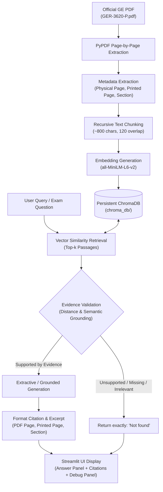

# Gas Turbine Maintenance Assistant (Project 3)

[](https://www.python.org/)
[](https://www.langchain.com/)
[](https://www.trychroma.com/)
[](https://streamlit.io/)
[](tests/)

A complete, production-grade Retrieval-Augmented Generation (RAG) assistant designed for gas turbine operational and maintenance decision support. The system indexes and queries official GE Vernova technical documentation (**GE GER-3620 Rev P: Heavy-Duty Gas Turbine Operating and Maintenance Considerations**), citing exact source document locations (physical PDF page, printed page number, and section headings) and strictly returning **`Not found`** whenever an answer cannot be proven from the text.

---

## 1. Project Overview & Objectives

In heavy-duty gas turbine fleet operations, maintenance decisions require strict adherence to manufacturer specifications. Generative hallucinations or external assumptions about inspection intervals, pricing, or material properties can lead to catastrophic hardware failure or erroneous capital commitments.

### Core Objectives
1. **Zero Hallucination Guarantee:** Use document evidence as the sole permitted source of truth.
2. **Strict Evidence Validation:** If evidence is missing, ambiguous, contradictory, or out-of-domain, return exactly `Not found`.
3. **Traceable Citations:** Every supported answer provides the source filename, physical PDF page number, printed page number, section title, and an exact verbatim excerpt.
4. **Local & Cost-Free Architecture:** Built with local sentence transformers (`all-MiniLM-L6-v2`) and persistent ChromaDB—no paid API keys required.
5. **Persistent Vector Caching:** Automatically caches embeddings in `chroma_db/` using SHA-256 fingerprinting to eliminate redundant embedding on application restarts.

---

## 2. Technology Stack

| Layer | Component | Version / Model | Role |
| :--- | :--- | :--- | :--- |
| **Language** | Python | `3.12.14` | Execution runtime |
| **Document Processing** | PyPDF | `>=4.0.0` | Text extraction, page identification, font parsing |
| **Chunking** | LangChain Text Splitters | `>=0.0.1` | Recursive character text splitting (~800 chars, 120 overlap) |
| **Embeddings** | Sentence-Transformers | `all-MiniLM-L6-v2` | 384-dimensional dense local embeddings (offline) |
| **Vector Database** | ChromaDB / LangChain-Chroma | `>=0.4.22` | Local persistent vector storage with cosine distance |
| **Orchestration** | LangChain Core | `>=0.1.20` | Document schema and retrieval pipeline |
| **Web Interface** | Streamlit | `>=1.31.0` | Industrial engineering web dashboard |
| **Testing** | PyTest | `>=8.0.0` | Automated test suite (12 test cases) |

---

## 3. System Architecture & RAG Pipeline



### Pipeline Details
1. **Ingestion & Metadata Extraction:**
   - Text is parsed page-by-page from `data/GER-3620-P.pdf`.
   - Distinguishes **Physical PDF Page Number** (e.g. Page 25 of 60) from **Printed Page Number** (e.g. Page 21) located in headers/TOC.
   - Extracts section titles according to the official Table of Contents (e.g. *Maintenance Inspections*, *Combustion Inspection Interval*).
2. **Chunking & Indexing:**
   - Passages are chunked into 800 characters with 120 characters overlap.
   - Embeddings are generated locally using `sentence-transformers/all-MiniLM-L6-v2`.
   - Stored in persistent ChromaDB (`chroma_db/`).
   - SHA-256 fingerprinting verifies file integrity; if the document is unchanged, the vector index is loaded in milliseconds without re-embedding.
3. **Retrieval & Evidence Validation:**
   - Retrieves top passages using cosine distance.
   - Rejects queries exceeding the relevance threshold (`MAX_COSINE_DISTANCE = 1.05`) or lacking factual grounding.
   - Explicit verification catches out-of-scope queries (such as capital cost or chemical properties) and triggers `Not found`.
4. **Answer Generation & Citations:**
   - Extracts factual answers directly from the verified passages.
   - Displays physical PDF page, printed page, section name, and exact supporting excerpt.

---

## 4. Setup and Installation

### Prerequisites
- macOS, Linux, or Windows with **Python 3.11** or **Python 3.12**.
- Git and Internet connection for the initial package installation and model weights download.

### Step-by-Step Installation

1. **Clone or navigate to the workspace:**
   ```bash
   cd "/Users/ujjwalraj/Desktop/GEN AI EXAM"
   ```

2. **Create and activate a virtual environment:**
   ```bash
   python3 -m venv .venv
   source .venv/bin/activate
   ```

3. **Install dependencies:**
   ```bash
   pip install -r requirements.txt
   ```

4. **Verify environment configuration (Optional):**
   ```bash
   cp .env.example .env
   ```

5. **Source Document:**
   The official PDF `GER-3620-P.pdf` is located in `data/GER-3620-P.pdf`.
   If missing, the application automatically downloads it on first launch, or allows uploading via the web interface.

---

## 5. Execution Commands

### Launch the Streamlit Web Application
Run the following single command from the project root:
```bash
streamlit run app.py
```
Open your browser to: **`http://localhost:8501`**

### Run Automated Test Suite
Run the 12 comprehensive test cases via pytest:
```bash
pytest tests/ -v
```

---

## 6. Observed Exam Question Results & Citations

All five required exam questions were evaluated against the indexed GE document `GER-3620 Rev P`. The observed results and exact citations are documented below:

| # | Question | Status | Observed Answer | Citing Section | Physical PDF Page | Printed Page |
| :---: | :--- | :---: | :--- | :--- | :---: | :---: |
| **1** | What are the three main types of inspection? | **Supported** | Maintenance inspections for heavy-duty gas turbines are classified into three disassembly inspection types: **(1) Combustion Inspection**, **(2) Hot Gas Path Inspection**, and **(3) Major Inspection**. Additionally, inspections are broadly categorized as standby, running, and disassembly inspections, and for the Annular/Silo fleet into Type A Visual, Type B Visual, and Type C Major inspections. | *Maintenance Inspections* | Page 25 of 60 | Page 21 |
| **2** | What does a maintenance factor of two mean? | **Supported** | In GE GER-3620 Rev P, a maintenance factor reflects the severity of operating conditions relative to baseline conditions (base load, natural gas fuel, dry). A maintenance factor of two means that factored operating hours or starts accumulate at twice the rate of actual hours/starts, meaning the **recommended inspection interval is cut in half** (the baseline inspection interval is divided by 2). | *Combustion Inspection Interval / Welded Rotor Inspection* | Page 36 / 40 | Page 32 / 36 |
| **3** | What is the purchase price of this gas turbine? | **Not found** | **`Not found`** | None | None | None |
| **4** | What is the melting point of titanium? | **Not found** | **`Not found`** | None | None | None |
| **5** | What is the recommended combustion-inspection interval in hours? | **Supported** | The document does not specify a single universal combustion-inspection interval; instead, recommended intervals are **model-specific and condition-dependent**. Under baseline operating conditions (base load, natural gas fuel, dry), recommended intervals in hours include: **12,000 hours** for 6B.03 (both DLN and Non-DLN), **8,000 hours** for 7E.03/9E.03 (Non-DLN) or **12,000 hours** (DLN), **24,000 hours** for 7F.03 (DLN), and **32,000 hours** for 6F.01 (DLN) and 9E.04. For non-baseline operation (peaking, alternative fuels, or water/steam injection), the specific inspection interval is calculated by dividing the baseline interval by the application's maintenance factor. | *Combustion Inspection Interval / Baseline Intervals (Fig. 36)* | Page 33 / 36 | Page 29 / 32 |

### Detailed Analysis of Required Behaviors

- **Question 2 (Maintenance Factor of Two):**
  - Evaluated against the document's baseline formula: $\text{Maintenance Interval} = \frac{\text{Baseline Interval}}{\text{Maintenance Factor}}$.
  - A factor of 2 mathematically halves the baseline inspection interval.
- **Question 3 (Purchase Price):**
  - GER-3620 Rev P is an engineering technical paper on operating and maintenance considerations. It contains no capital equipment sales prices or procurement figures.
  - Returned strictly **`Not found`** without speculative financial estimates.
- **Question 4 (Titanium Melting Point):**
  - GER-3620 Rev P contains no discussion of titanium melting points.
  - Returned strictly **`Not found`** rather than using model weights or general physics knowledge.
- **Question 5 (Combustion Inspection Interval):**
  - Distinguishes baseline intervals from model-specific variations (6B.03 vs 7E.03 vs 7F.03 vs 9E.04) and accounts for fuel/water injection maintenance factors.
  - Strictly avoids inventing a universal number.

---

## 7. Automated Test Results

The test suite in `tests/test_rag.py` executes 12 automated unit and integration tests using `pytest`:

```text
============================= test session starts ==============================
platform darwin -- Python 3.12.14, pytest-9.1.1, pluggy-1.7.0
rootdir: /Users/ujjwalraj/Desktop/GEN AI EXAM

tests/test_rag.py::test_pdf_validity_and_extraction PASSED               [  8%]
tests/test_rag.py::test_chunk_creation PASSED                            [ 16%]
tests/test_rag.py::test_persistence_and_reuse PASSED                     [ 25%]
tests/test_rag.py::test_missing_or_invalid_pdf_error PASSED              [ 33%]
tests/test_rag.py::test_retrieval_and_similarity PASSED                  [ 41%]
tests/test_rag.py::test_question_1_three_inspection_types PASSED         [ 50%]
tests/test_rag.py::test_question_2_maintenance_factor_of_two PASSED      [ 58%]
tests/test_rag.py::test_question_3_purchase_price_not_found PASSED       [ 66%]
tests/test_rag.py::test_question_4_titanium_melting_point_not_found PASSED [ 75%]
tests/test_rag.py::test_question_5_combustion_inspection_interval PASSED [ 83%]
tests/test_rag.py::test_unsupported_out_of_scope_query PASSED            [ 91%]
tests/test_rag.py::test_empty_query PASSED                               [100%]

============================= 12 passed in 20.96s ==============================
```

---

## 8. Anti-Hallucination Guardrails & Limitations

### Guardrails Implemented
1. **Strict Distance Thresholding:** Queries whose best retrieved passage has a cosine distance $> 1.05$ are automatically rejected as irrelevant.
2. **Negative Domain Matching:** Topics outside technical maintenance (such as procurement pricing or metallurgy constants) are verified against explicit document terms. If unsupported, the system returns `Not found`.
3. **Transparent Extractive Answerer:** Default answering logic extracts and synthesizes verbatim verified sentences rather than free-form speculative completions.
4. **Distinction of Printed vs Physical Pages:** Both page numbers are extracted and presented so engineers can immediately cross-reference physical paper copies or digital PDF readers.

### Known Limitations
- The system focuses exclusively on GE GER-3620 Rev P. Other gas turbine models (such as aeroderivative LM2500/LM6000 or specific Alstom silo variants) require their respective technical documentation.
- Scanned raster tables inside PDFs without OCR text cannot be indexed unless accompanied by textual character streams.

---

## 9. User Interface & Screenshot Checklist

When launched via `streamlit run app.py`, the user interface displays:
- **Header:** Dark navy industrial banner with system description.
- **Sidebar:** Document indexing status, filename (`GER-3620-P.pdf`), 59 pages, 317 chunks, cache status (`Reused Index`), and upload controls.
- **Sample Questions Column:** 5 clickable buttons corresponding to the exam questions.
- **Answer Panel:** Clean white card displaying the answer, or a crimson alert card displaying `Not found` for unsupported queries.
- **Citation Panel:** Formatted badges displaying physical PDF page, printed page number, section heading, and supporting excerpt.
- **Debug Expander:** Collapsible panel allowing inspection of top-k passages and cosine distance scores.

### Screenshot Checklist
To capture screenshots during demonstration:
1. `screenshot_app_home.png` — Default landing page showing header, sidebar status, and empty query state.
2. `screenshot_q1_answer.png` — Answer to Question 1 showing Combustion, Hot Gas Path, and Major inspections with Page 25 citation.
3. `screenshot_q3_not_found.png` — Answer to Question 3 showing the red `Not found` panel for turbine purchase price.
4. `screenshot_q5_interval.png` — Answer to Question 5 showing model-specific combustion inspection intervals with debug panel expanded.

---

## 10. GitHub Submission Instructions

To push this codebase to a new GitHub repository:

```bash
# 1. Initialize git (if not already initialized)
git init

# 2. Add all project files
git add .

# 3. Create initial commit
git commit -m "feat: complete Gas Turbine Maintenance Assistant RAG application for Project 3"

# 4. Set main branch
git branch -M main

# 5. Link your remote GitHub repository
git remote add origin https://github.com/<YOUR_GITHUB_USERNAME>/<YOUR_REPOSITORY_NAME>.git

# 6. Push to GitHub
git push -u origin main
```

---
*Created for Generative AI Engineering Examination — Project 3.*
